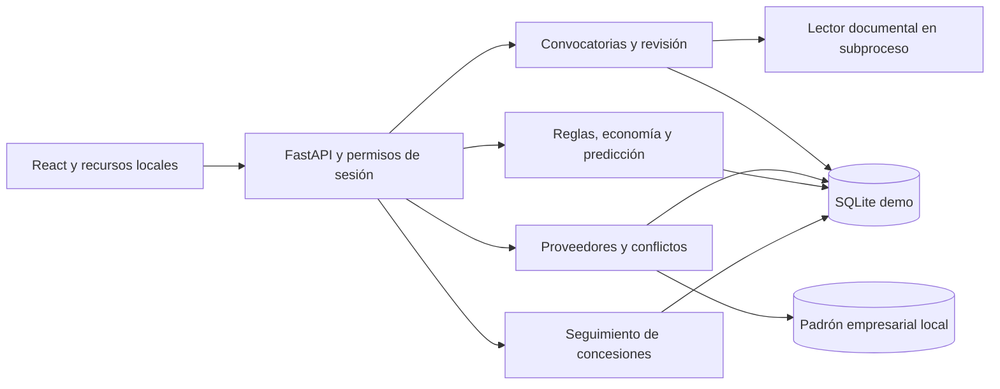

# Arquitectura

El navegador y la API se sirven en el mismo origen. Un proceso Uvicorn ejecuta el monolito modular. Las consultas de listado se paginan en SQL. El conjunto histórico se analiza en memoria y queda protegido por un bloqueo durante el reanálisis. Los documentos de una propuesta se recuperan bajo demanda. SQLite mantiene claves foráneas, WAL y un tiempo de espera para escritura.

El cliente pide importes, series y evaluaciones a la API. Su lógica propia presenta formularios, gráficos y filtros. Las transacciones de resultado crean la concesión y sus cuotas conjuntamente. La identidad del evaluador y la versión de bases delimitan sus calificaciones.

La API conserva las rutas 2.0 y publica OpenAPI en `/api/openapi.json` para sesiones autorizadas. Los routers de convocatorias, integridad, panel, operación y predicción se registran en `app.py`. El frontend usa rutas hash, por ejemplo `#convocatorias/1`. La compilación final vive en `frontend/dist`.

La instalación soportada usa un trabajador. Un despliegue con varios trabajadores requiere sesiones compartidas, coordinación del análisis y migraciones explícitas para PostgreSQL. Los informes largos y algunos agregados de esta demo leen la selección en memoria.
