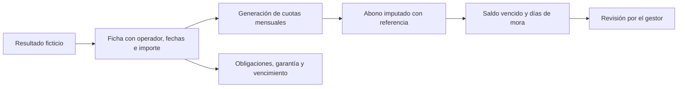

# Concesiones y seguimiento

La contraprestación se recibe desde la perspectiva de la universidad. Cada cuota vence al fin del mes o al término si éste ocurre antes. El cálculo usa únicamente abonos registrados hasta el corte. El cumplimiento expresa pago imputable sobre exigible. Si el denominador vale cero se muestra «No evaluado». El saldo vencido suma el importe pendiente en las cuotas cuyo plazo ya pasó.

Los ejemplos históricos incluyen un operador al día, una concesión con mora y garantía vencida y una concesión finalizada por fecha. En la ficha se consultan C01 por término vencido, C02 por saldo vencido, C03 por garantía vencida durante la vigencia y C11 por obligación de supervisión vencida. Los registros se pueden contrastar con la tabla de cuotas.

El simulador usa la perspectiva mensual del operador. Flujo = ingresos − costos operativos − contraprestación. El escenario pesimista multiplica ingresos por 0,85 y costos por 1,10. El optimista aplica 1,15 y 0,95. El escenario base mantiene los importes de entrada. Ningún escenario modifica el contrato. El catálogo inicial no ofrece un IRC integral, TIR ni VAN.
