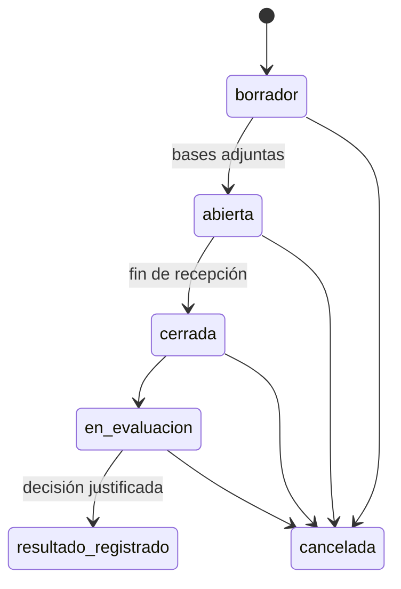

# Convocatorias

El asistente recoge datos generales, bases, requisitos, criterios, intervinientes y revisión. Cada base debe pertenecer a un borrador. La suma de pesos debe ser 100. El código es único. El servidor comprueba fechas e importes positivos y rechaza requisitos o criterios duplicados.

La edición está disponible en borrador. Cada cambio requiere la versión esperada. La apertura es un registro interno de la demo. Los postulantes se seleccionan del catálogo y una restricción de unicidad evita registrarlos dos veces. La recepción cerrada bloquea nuevas propuestas.

Las notas del evaluador se conservan por criterio, versión de bases y postulante. El resultado simulado exige identificar una postulación y una revisión previa que cubra los últimos cambios documentales o calificaciones del postulante. Si la modalidad es concesión se crea el seguimiento en la misma transacción. El flujo completo se prueba en `tests/test_convocatorias.py`.
