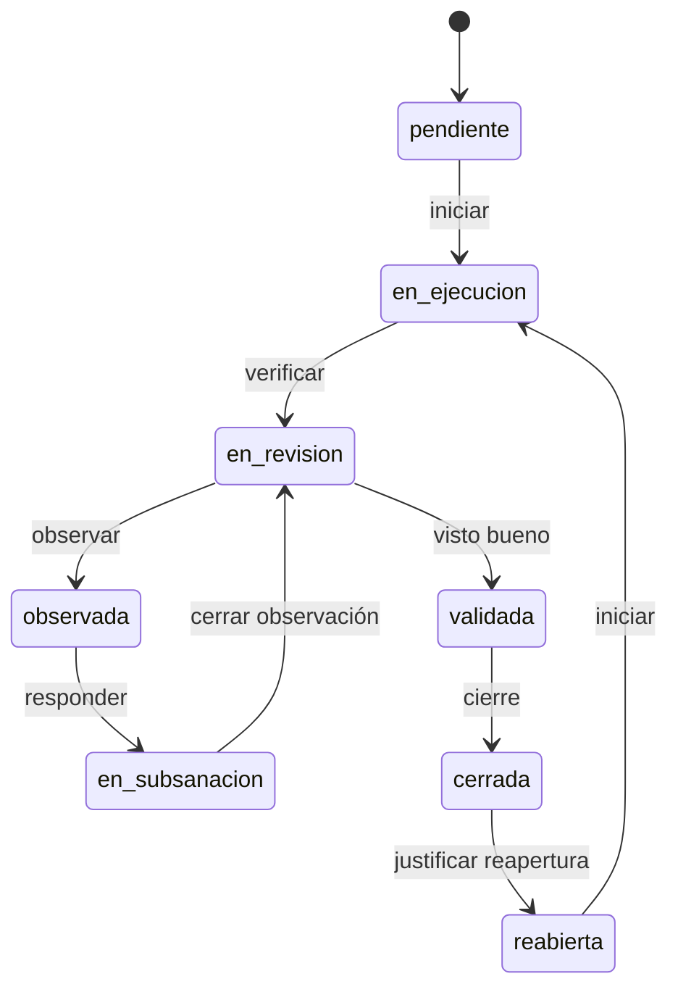

# Flujo de procesos

El servicio valida estados, revisión optimista y requisitos. Las transacciones `BEGIN IMMEDIATE` serializan modificaciones SQLite. La fase 7 requiere conformidad cerrada y libre de observaciones y el pago se registra como evidencia, no como transacción bancaria. Se usa secuencia lineal para las dos plantillas iniciales; excepciones autorizadas y caminos paralelos no implementados.
