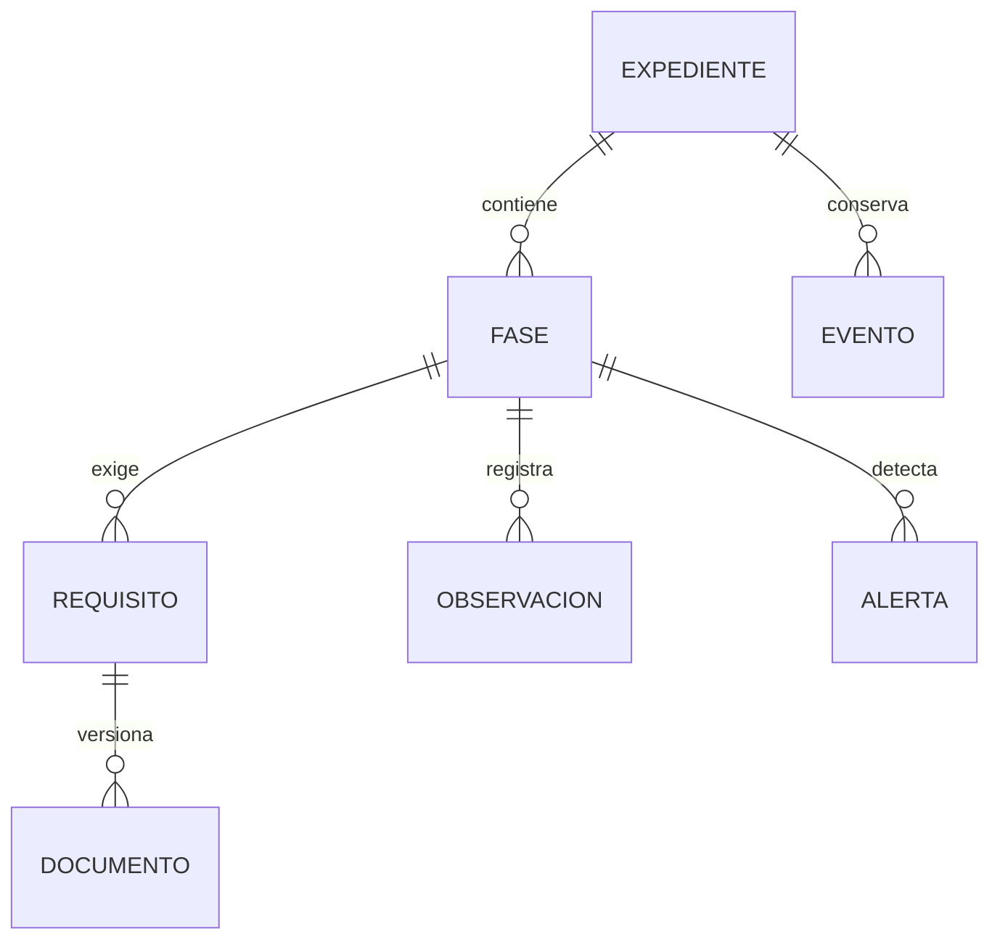

# Gestión de expedientes

Un expediente posee código único, tipo, objeto, área, responsable, inicio y monto. Dos plantillas iniciales de ocho fases (servicios y concesión) se guardan como copia JSON versionada en el expediente. El usuario puede asignar responsable y plazo. Los requisitos se instancian al crear el expediente.

## Modelo de datos

Los archivos se conservan en SQLite (máximo 4 MiB por archivo, PDF/DOCX/XLSX/TXT/CSV); se emplean SHA-256, control de versión y validación de MIME. La revisión exige la última versión del requisito. El original permanece disponible según permiso. No se verifica la autenticidad o firma digital ni se presenta una comparación semántica de documentos.
