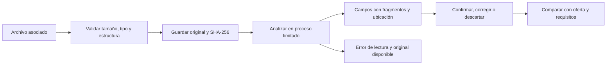

# TrazaDocs

Acepta PDF con texto, DOCX, XLSX, CSV y TXT de hasta 4 MiB. El lector comprueba nombre y extensión, firma PDF o estructura de paquete Office y correspondencia MIME. Los paquetes tienen límites de miembros y tamaño expandido. Las macros y objetos incrustados se rechazan. Las fórmulas de hoja de cálculo se omiten. La extracción sobre archivos subidos tiene un límite de memoria y un tiempo máximo de 15 segundos.

La extracción reconoce etiquetas como RUC, razón social, oferta, garantía e ingresos mensuales. Un valor monetario se normaliza a decimal. Cada resultado incluye página, párrafo, línea o rango de celdas. En un PDF de imagen o un documento de redacción libre puede ser necesaria lectura manual. La confianza corresponde a reglas de extracción y formato.

La corrección registra la justificación y conserva el valor original. Los archivos se descargan desde una ruta autenticada. La interfaz muestra el fragmento y la ubicación junto con el acceso al original. Verificar autenticidad de firmas, lectura de imágenes y búsqueda semántica de cláusulas quedan para una fase posterior.
