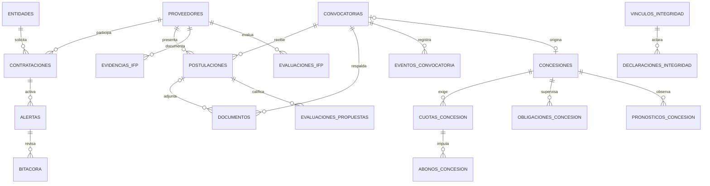

# Modelo de datos y conservación

La semilla y el arranque crean tablas ausentes y respetan las decisiones ya registradas. Antes de abrir un archivo existente se comprueba que su esquema corresponde a la demo y que sus proveedores tienen identificadores sintéticos. Un RUC reservado de cafetería ocupado por un registro ajeno detiene la carga.

Para actualizar desde 2.0, detén el servidor y respalda la carpeta de datos antes de usar la nueva versión. Las tablas históricas se conservan. Un segundo arranque recupera propuestas, evidencias, decisiones y pagos. El modelo conserva los originales, las versiones de extracción y la bitácora de correcciones. La restauración consiste en volver al respaldo con la aplicación detenida.
