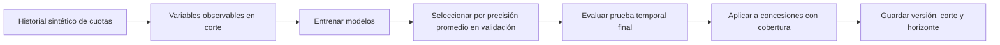

# TrazaPredict

**Evento**. Saldo pendiente treinta días después del vencimiento de la siguiente cuota mensual de una concesión. Cada observación se sitúa el día 23 del mes. El simulador de entrenamiento produce fechas de pago para 48 operadores ficticios y 72 meses desde enero de 2020. La semilla es 42.

Las variables describen las últimas tres cuotas vencidas. Se cuentan cuotas abiertas y cuotas pagadas fuera de fecha, y se promedia la demora observada con tope de 90 días. Un pago posterior al corte figura como pendiente. Las fechas del próximo pago y los identificadores de empresa se excluyen de las variables.

La etiqueta de entrenamiento debe madurar antes del primer corte de validación. Se aplica la misma separación antes de la prueba. Se ajustan un clasificador de frecuencia, una regresión logística escalada y un bosque aleatorio. La precisión promedio de validación elige el modelo y el F1 de validación orienta el umbral de revisión. La prueba final se reserva para el informe y un control mínimo frente a la base de referencia.

La aplicación calcula variables sobre cuotas y abonos demo con el mismo método. Se requieren tres cuotas anteriores, concesión vigente y próxima cuota dentro de 31 días. La salida individual es una categoría con horizonte, acción y factores. «Actualizar evaluación» vuelve a consultar la base. El servicio guarda resultados con la versión mora-cuota-1.0. El detalle de métricas vive en [Validación de modelos](VALIDACION_MODELOS.md).
