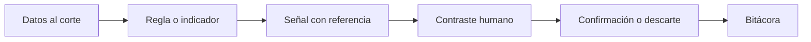

# Motor de alertas

La revisión de los expedientes históricos opera en `/api/alertas`. Una alerta se identifica por expediente y regla. Reejecutar el análisis conserva decisiones y movimientos. Las señales fuera de vigencia permanecen disponibles en el historial y la exportación. Una decisión debe contener el estado que el analista observó, el nuevo estado y el comentario.

El centro ofrece una vista de expedientes y una bandeja por familia. La bandeja agrega D de documentos, R de integridad y expedientes, C de concesiones y P de prevención. Para los expedientes históricos resume los doce pendientes con mayor score. El listado paginado principal conserva el conjunto completo. La clave de lectura deriva de la señal, referencia, destino y explicación. Se marca leído por cuenta.

C10 presenta un saldo estimado negativo bajo supuestos declarados. P03 comunica la categoría de revisión del modelo de mora. Actualizar la bandeja consulta de nuevo sus fuentes. El monitoreo se realiza al consultar o al ejecutar la reevaluación, sin un servicio programado en segundo plano.
