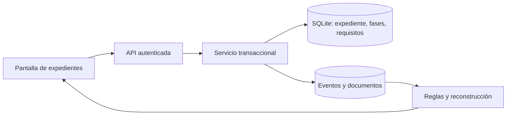

# TrazaUNT 3.2 — núcleo operativo de expedientes (prototipo)

Inicio: ejecutar `iniciar.bat`, entrar al espacio de trabajo y abrir **Expedientes y trazabilidad**. También está disponible en `http://127.0.0.1:8000/trazabilidad` con sesión iniciada.

La extensión utiliza FastAPI, SQLAlchemy y SQLite, con una pantalla web sin dependencias externas, integrada a la navegación React y a la sesión existente. Se añade un esquema `tz_*` sin eliminar tablas de 3.1. No reemplaza la operación anterior ni publica datos privados en el portal público.

## Demostración reproducible

1. Abrir el caso observado de mantenimiento preventivo. En fase 6 existe una observación abierta, aun cuando consta el cierre sintético; en fase 7 consta un pago.
2. Analizar expediente. Se esperan TZ04 y TZ05. Abrir TZ04 y comparar detección (Pago) y posible origen (Conformidad). Consultar actores, documentos y cronología.
3. Registrar una revisión humana con sustento. El historial conserva la decisión. Imprimir el informe desde su pestaña.
4. Abrir el caso correcto: no se esperan alertas. Crear otro expediente, cargar documentos, verificar su versión vigente, observar, subsanar, validar y cerrar una fase.

Los casos se insertan solo en modo demo; se generan actuaciones ficticias directamente para representar una importación irregular, no mediante la API de operación. Los nombres y evidencias son sintéticos. Las referencias y los hashes no prueban autenticidad ni responsabilidad legal.

## Alcance y pendientes

P0: flujo básico, dos plantillas estáticas versionadas, códigos, requisitos, documentación con versiones, observaciones, subsanaciones, visto bueno, pago registrado (sin transferencias reales), historial, revisión humana e informe imprimible. No existe editor de plantillas, borrador separado, gestión exhaustiva de requisitos específicos, autorizaciones diferenciadas, pagos parciales, ni firma digital. Los vínculos a módulos existentes son por ID y claves foráneas; aún no sincronizan automáticamente todos los eventos de dichos módulos ni extraen automáticamente datos de TrazaDocs. La pantalla usa HTML/JS y el bundle React disponible tiene un ajuste de navegación; no se reconstruyó con Vite. P1: sucesión directa, algunas comprobaciones de reglas y tablero resumido; faltan RACI completo, conformance checking integral, variantes/duraciones y análisis global. P2: no se implementó nuevo entrenamiento predictivo, TF-IDF, simulación ni verificación del encadenamiento de hashes; se conserva el motor anterior. No se certifica uso en producción. No se ejecutaron pruebas React/Vite/E2E de navegador en este entorno.
